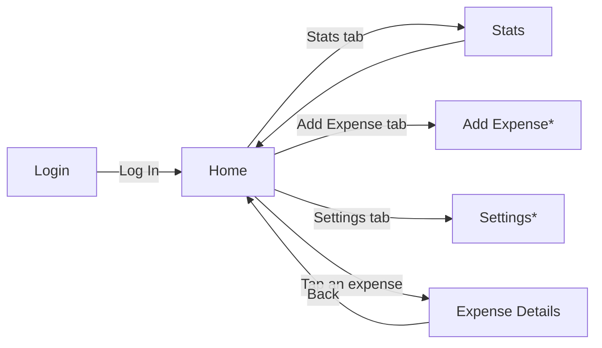

# SpendWise 

**A simple personal expense tracker built with Flutter.**

SpendWise helps people record their daily spending, stay within a monthly budget, and understand where their money goes, using clear summaries and charts.

> **Status:** Week 2 UI prototype. The screens are built and connected with sample data. Real authentication, a database, and full add/edit/delete are planned for later weeks.

---

## Table of Contents

1. [Project Vision](#project-vision)
2. [Objectives](#objectives)
3. [Features](#features)
4. [Screens and Screenshots](#screens-and-screenshots)
5. [Navigation Flow](#navigation-flow)
6. [Project Structure](#project-structure)
7. [Getting Started](#getting-started)
8. [Design](#design)
9. [Roadmap](#roadmap)
10. [Team and Workflow](#team-and-workflow)

---

## Project Vision

Many people reach the end of the month unsure where their money went. Spreadsheets are tedious, and many finance apps are cluttered. SpendWise aims to be a fast, friendly, and uncluttered way to log expenses in a few taps and see clearly how much of the budget is left.

## Objectives

- Make logging an expense quick and effortless.
- Give users an at-a-glance view of what they have spent and what remains in their budget.
- Show which categories take up the largest share of their spending.
- Warn users before they overspend, not after.
- Build a clean, consistent Flutter UI based on our Figma design, using reusable widgets.

## Features

**In the current prototype (sample data)**

- **Login:** welcome screen with email and password fields.
- **Home / Dashboard:** total balance, weekly spending chart, and recent expenses.
- **Stats:** weekly date selector, daily spending donut chart, and a budget breakdown by category (Groceries, Food & Drink, Bills).
- **Expense Details:** amount, merchant, date, category, payment method, notes, and receipt placeholder.
- **Bottom navigation** shared across the main screens.

**Planned**

- Add, edit, and delete expenses
- Monthly budget with a warning when spending nears the limit
- Weekly and monthly spending reports
- Real authentication and persistent storage

## Screens and Screenshots

| Login | Home | Stats | Expense Details |
|:---:|:---:|:---:|:---:|
|  |  |  |  |

> Screenshots go in `docs/screenshots/`. Replace the file names above if yours are different.

## Navigation Flow



\* Placeholder screens for now.

In words:

1. The user opens the app on the **Login** screen and taps **Log In**.
2. They land on **Home**, which shows their balance, weekly spending, and recent expenses. After logging in, the back button does not return to Login.
3. The **bottom navigation bar** (Home, Add Expense, Settings, Stats) switches between the main sections.
4. Tapping an expense on Home opens **Expense Details**, and the back button returns to where the user came from.

## Project Structure

```
lib/
├── main.dart          # App entry point and theme
├── screens/           # Full pages (login, home, stats, expense details)
├── widgets/           # Reusable components (budget card, bottom nav, donut chart, ...)
├── models/            # Data classes and sample data
└── theme/             # App colors and theme
```

## Getting Started

**Prerequisites:** [Flutter SDK](https://docs.flutter.dev/get-started/install) and an emulator, simulator, or physical device (or Chrome for web).

```bash
# 1. Clone the repository
git clone <repository-url>
cd Spend_wise_app

# 2. Install dependencies
flutter pub get

# 3. Run the app
flutter run
```

To check your setup, run `flutter doctor`.

## Design

- **Wireframes / UI design:** [Figma link](#) *(add link)*
- **Style:** a soft green palette, rounded white cards, and clear typography. Colors are defined in `lib/theme/app_colors.dart`.

## Roadmap

- [x] Week 1: proposal, wireframes, repository setup
- [x] Week 2: UI prototype with navigation (sample data)
- [ ] Week 3: connect real data, working add/edit/delete
- [ ] Later: monthly budget warnings, reports, authentication, storage

## Team and Workflow

**Team 3 (0510 SLU MAD)**

- Shimaa Kamal M
- Adeniyi Adeyinka
- Ange Mukundente
- Sabikun Naher Meem
- Chaudhary Siddhant Baliyan
- Emama
- Eseosa Ogolo
- Kevin Okhale
- Sandile Ndroi
- Shariana Dee
- Mohana Aswath

**Git workflow:** each contributor works on a separate branch (for example `feature/stats-screen`), commits with clear messages, and opens a pull request into `main`.

---

Built as part of a mobile app internship.
